# BusPulse Delhi: bus times from real buses on the road

**Built for the [Transport Stack Hackathon 2026, Delhi](https://delhi.transportstack.in/hackathon)** (Delhi Transport Stack, Phase 1)<br>
**Problem 1: Real-time bus traffic model and journey planner** (+ Problem 2's crowding as a layer)


### ▶ Live demo: **[buspulse-delhi.onrender.com](https://buspulse-delhi.onrender.com)**
<sub>Free hosting: the first visit after a quiet spell can take about a minute to wake up. API docs: [/docs](https://buspulse-delhi.onrender.com/docs)</sub>

<p>
  <a href="docs/VALIDATION.md"></a>
  <a href="docs/TECH_NOTE.md"></a>
  <a href="#quick-start"></a>
  <a href="tests/"></a>
</p>

<p align="center">
  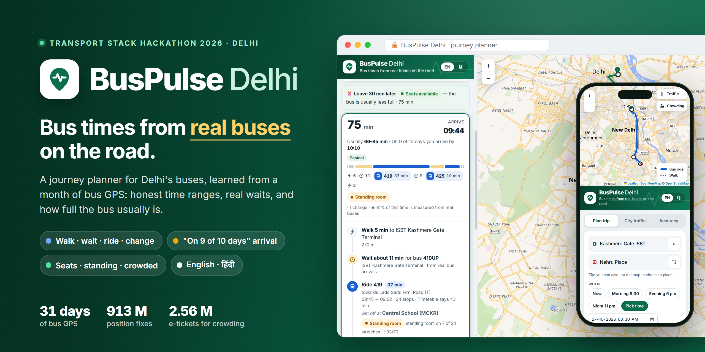
</p>

> **6 pm, bus 507, Okhla Extension → Lajpat Nagar.** The timetable says **23 min**, Google Maps **28**.
> BusPulse says **52**. The real buses that week took **53**.

> **What it is:** a bus journey planner for Delhi whose travel times come from real bus GPS, not the timetable.
> It gives a time range you can plan around, realistic waits, how full the bus usually is, and a Hindi toggle.

**[Screenshots](#screenshots) · [Validation](docs/VALIDATION.md) · [How it works](#how-it-works) · [API](#api) · [Tech note](docs/TECH_NOTE.md) · [Proposal (PDF)](docs/BusPulse_Proposal.pdf) · [Demo video (MP4)](docs/BusPulse_demo.mp4) · [Who rides Delhi's buses](docs/USER_RESEARCH.md) · [Limits](#limits-honestly)**

<p align="center">
  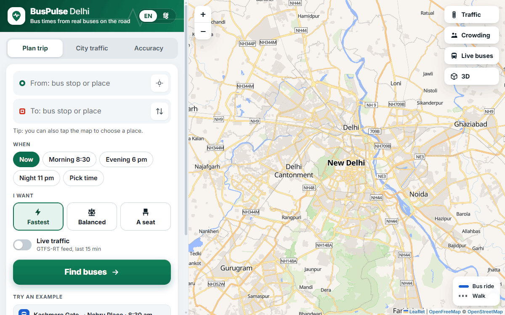
  <br><sub><b>30 s walkthrough</b> · search → plan → journey steps → हिंदी → City traffic → Accuracy → 3D → live buses (the real app, recorded screen by screen)</sub>
</p>

Local: `pip install -r requirements.txt && python run.py` → http://localhost:8000

Delhi's buses are moving traffic sensors. BusPulse turns **31 days of bus GPS (124 GB, 913 M position fixes)**
into a model of how long a bus really takes on every stretch between two stops, at every hour of a weekday,
Saturday and Sunday. Then it plans bus journeys on that model: walk, board, ride, change, walk, with a **reliability range
that holds on real trips**, **realistic waits**, the **same trip at a quieter hour**, and **how full the bus
usually is**.

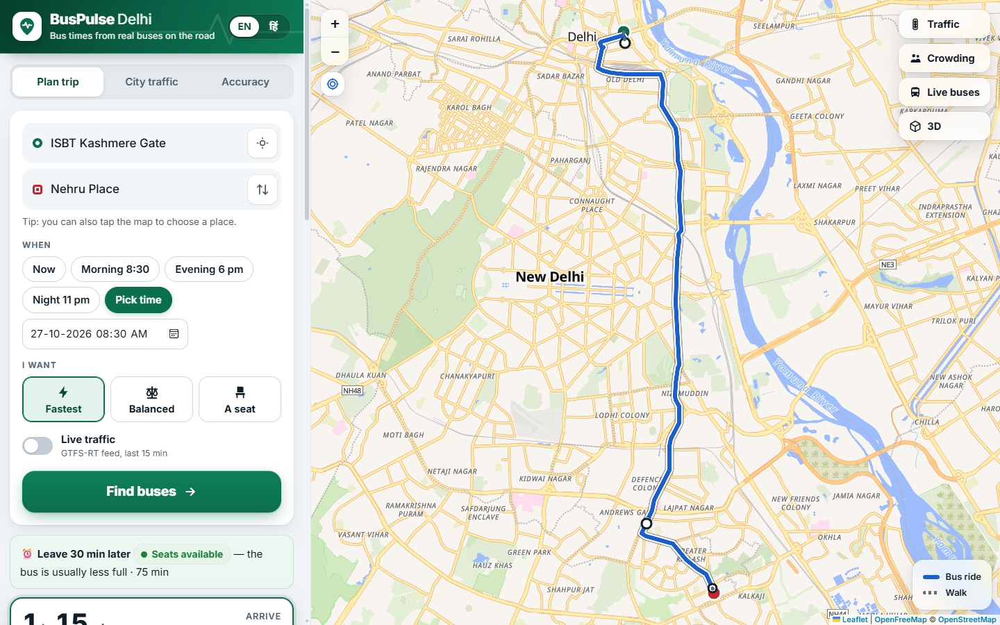

## Headline results (held-out week, real buses)

Trained on 1–24 Oct; everything below is measured on **25–31 Oct**, which the model never saw.
Full report: **[docs/VALIDATION.md](docs/VALIDATION.md)**.

**Travel time on the bus** (what the model predicts; errors in minutes against real buses):

| | average error | typical error (median) | within ±20 % |
|---|---|---|---|
| **BusPulse**: real bus trips of 5–30 stops (42,000, median 7 min) | **1.61 min** | **0.79 min** | **71 %** |
| BusPulse + live data (last 15 min of GPS) | **1.44 min** | **0.74 min** | **75 %** |
| Official timetable | 2.84 min | 1.84 min | 38 % |
| One speed for the whole city | 3.65 min | 2.41 min | 26 % |
| **BusPulse**: whole planned bus rides vs the real buses of that route that day (378, median 21 min) | **4.49 min** | **2.14 min** | **70 %** |
| Official timetable, same rides | 6.74 min | 3.99 min | 46 % |

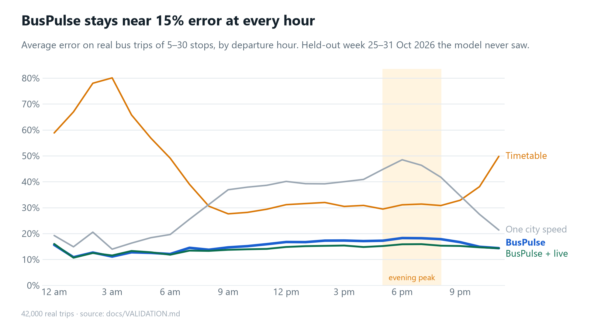

**The whole journey**: what a rider actually lives through. Few planners check this, because it includes the
random wait for the bus:

| | GTFS timetable | **BusPulse** |
|---|---|---|
| **Door to door** (walk + real wait + real ride, 96 trips, median 72 min): average error · within ±20 % | 12.1 min · 66 % | **8.7 min · 80 %** |
| … MAPE | 17.0 % | **12.4 %** |
| "On 9 of 10 days you arrive by …": real rides that made it | n/a | **89.9 %** (claimed 90 %) |
| Wait at the stop: average error vs real departures | −7.1 min | **−2.8 min** |
| **vs Google Maps**: trips checkable against real buses (15 of 47), average difference from the real trip | Google 17.4 min | **8.7 min**, closer on 10 of 15 |
| Answer time for a full journey plan (one user) | n/a | **≈ 0.5 s** |

What the GPS revealed: buses run **22 % slower than the timetable** at the evening peak (median route), **23 km/h
at 6 pm vs 35 km/h at 11 pm**, and real waits are about **twice** what the timetable implies. On routes the GPS
barely sees, real waits are **~6×** the timetable's promise, so the planner steers riders towards routes that run.
**Versus Google Maps** (47 bus-only trips at 08:30 and 18:00): in the morning we agree (median difference 12 %).
At 6 pm Google's times barely change (65 min average vs 64 in the morning) while BusPulse expects 90, because
the real buses crawl. On the trips we could check against real buses, BusPulse was off by 8.7 min and Google
by 17.4. Example: bus 507 Okhla Extension → Lajpat Nagar at 6 pm: Google ~28 min ride, BusPulse 52, real
buses 53 (median of 7). Details and where we lose: [docs/VALIDATION.md §3](docs/VALIDATION.md).

## What it does

<table>
<tr>
<td width="25%" valign="top"><br><b>Door to door</b><br><sub>Walk, board, ride, change, walk. Stop names with typos, Delhi nicknames, addresses or a tap on the map.</sub></td>
<td width="25%" valign="top"><br><b>Times that follow the clock</b><br><sub>08:30 on a Tuesday is not 23:00 or a Sunday. Stretch speeds by hour and day type.</sub></td>
<td width="25%" valign="top"><br><b>A range you can plan on</b><br><sub>"Usually 37–41 min · on 9 of 10 days you arrive by 09:13", checked on a held-out week.</sub></td>
<td width="25%" valign="top"><br><b>Real waits</b><br><sub>From real bus departures, bunching included, and a nudge towards routes that actually run.</sub></td>
</tr>
<tr>
<td valign="top"><br><b>How full the bus is</b><br><sub>Seats / standing / crowded per leg from 2.56 M e-tickets, and "leave 15 min later for a seat".</sub></td>
<td valign="top"><br><b>Live + historical</b><br><sub>GTFS-RT connector with the same stop-visit code as the pipeline; the demo replays the held-out Tuesday.</sub></td>
<td valign="top"><br><b>City traffic for operators</b><br><sub>Bus speed on every stretch by hour, slowest stretches, timetable vs reality by route.</sub></td>
<td valign="top"><br><b>For every rider</b><br><sub>Big type, icons, one answer first, one-tap examples, English · हिंदी, works on phones.</sub></td>
</tr>
</table>

* **Origin → destination** (stop name with typos, Delhi nicknames like "cp" or "ndls", an address or landmark via
  OpenStreetMap, `lat,lon`, or a tap on the map) + departure time → 2–3 options, each with walk to stop, boarding stop, route, wait, ride, alighting stop,
  changes, walk, total and arrival.
* **Times change with the hour and day.** 08:30 on a Tuesday is not 23:00 or a Sunday; night queries roll to the
  first useful bus.
* **"Usually 37–41 min · on 9 of 10 days you arrive by 09:13"**: a range calibrated on real rides of training days
  and checked on the held-out week.
* **Waits from real bus departures**, including bunching (two buses together, then a long gap).
* **Live + historical blend.** A **GTFS-RT connector** (`app/gtfsrt.py`) reads a VehiclePositions feed:
  set `BUSPULSE_GTFSRT_URL` and, if the feed needs a key, `BUSPULSE_GTFSRT_HEADERS="x-api-key: …"`. It measures
  stop-to-stop times with the same code as the historical pipeline, and on 27 Oct's GPS replayed as a feed it
  matches the offline numbers within 1 % ([LIVE_CONNECTOR.md](docs/LIVE_CONNECTOR.md)). **Running on the real
  Transport Stack feed** (24 Nov 2026): 5,424 buses tracked and 649 stop-to-stop runs measured in the first
  90 seconds. Without a key, the demo replays the held-out Tuesday.
* **Your buses near you**: plan a trip for "now" and the real buses of your route that are near your stop
  appear on the map as vehicles, like a ride-hailing app ("425 · 2 buses · nearest 2.4 km").
* **Crowding** (seats / standing / crowded) per leg from 2.56 M e-tickets; **Fastest / Balanced / A seat** toggle;
  "leave 15 min later for a seat".
* **City traffic tab** for operators: bus speed on every stretch by hour, slowest stretches at 6 pm vs 11 pm,
  timetable vs reality by route.
* Simple UI for everyday riders: big type, icons, one answer first, one-tap examples, **Hindi toggle**, works on
  phones.

## Screenshots

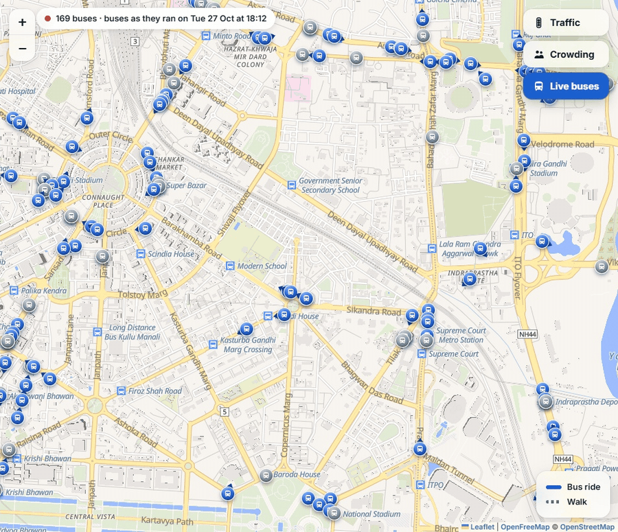

**Live buses** · every bus on the road, gliding along its route with heading and route number (`/live/vehicles`:
the GTFS-RT feed when connected, otherwise the held-out Tuesday at today's clock time).

<table>
<tr>
<td width="50%" valign="top">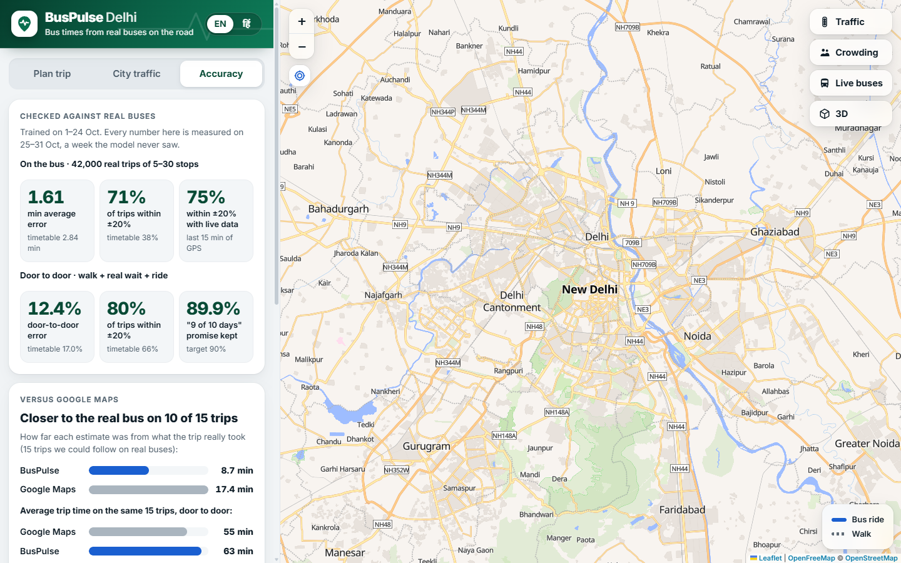<br><b>Accuracy tab</b> · the held-out validation, inside the app</td>
<td width="50%" valign="top">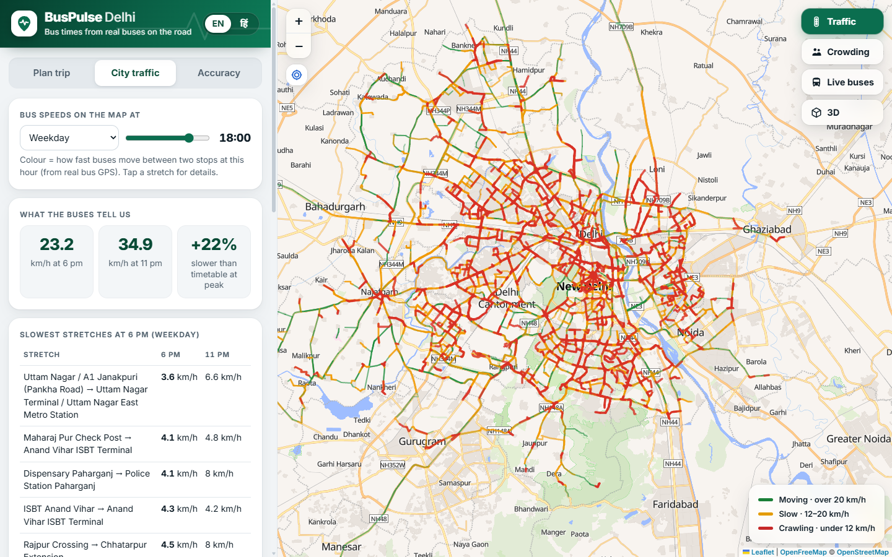<br><b>City traffic</b> · bus speed on every stretch, weekday 6 pm</td>
</tr>
<tr>
<td valign="top">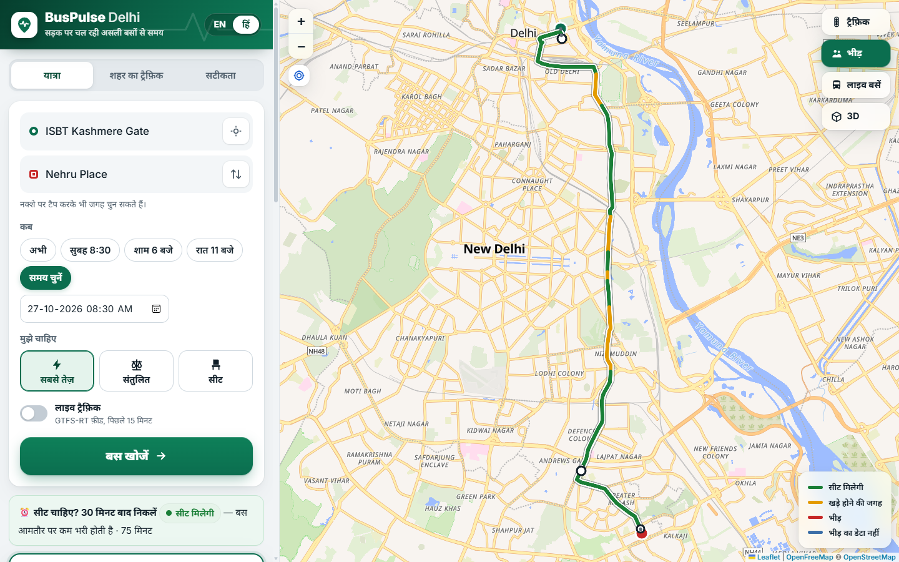<br><b>हिंदी</b> · the whole app in Hindi; the ride coloured by how full the bus gets</td>
<td valign="top">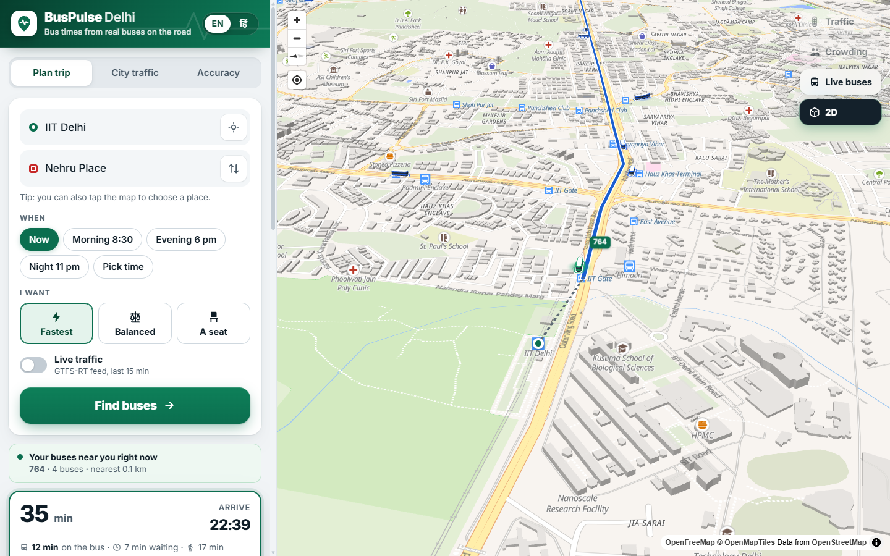<br><b>3D + live buses</b> · your route among the buildings, real buses on the road (yours in green)</td>
</tr>
</table>

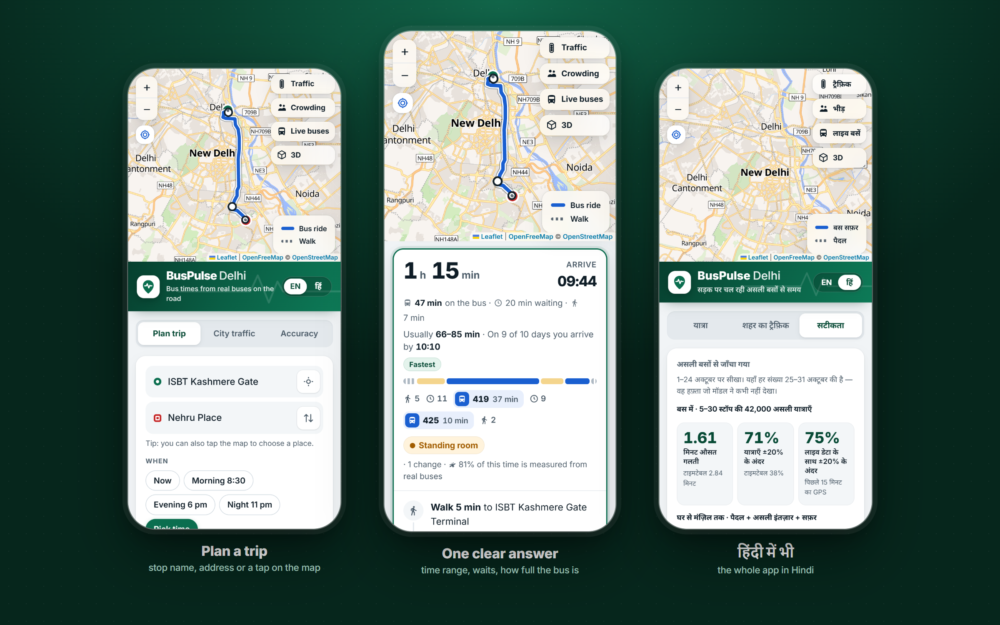

**On a phone** · map on top, one answer first, the whole app in Hindi.

## Quick start

```bash
pip install -r requirements.txt
python run.py                      # → http://localhost:8000   (API docs at /docs)
```

The repo ships compact model files in `bundle/` (about 50 MB; the deploy runs with `BUSPULSE_DATA=bundle`), so the app
runs without the raw data. To rebuild everything from the raw data:

```bash
# data/raw/delhi-dtc-bus-gtfs-rt-2026-10.7z, data/tickets/October-Delhi.csv, data/gtfs/<GTFS zip>  (downloads: delhi.transportstack.in)
python scripts/00_inspect.py --skip-gps      # GTFS + ticket matching check
python scripts/01_gps_extract.py --workers 3 # GPS → stop visits + stop-to-stop observations, a day at a time (resumable)
python scripts/02_build_traveltime.py        # model tables, GPS waits, chain + whole-ride calibration (training days)
python scripts/03_tickets_crowding.py        # crowding
python scripts/07_insights.py                # operator insights
python scripts/04_validate.py                # held-out validation: stop-to-stop chains
python scripts/11_validate_rides.py          # held-out validation: whole rides and waits
python scripts/10_experiments.py --inner     # model selection (train 1–17, test 18–24 Oct)
python scripts/05_google_compare.py          # vs Google Maps (needs data/google_benchmark.csv)
python scripts/08_data_quality.py            # data quality report
python scripts/09_bundle.py                  # refresh bundle/ for deploys
```

Windows: `scripts\make_all.ps1` runs 02 → 09 plus the stress test. Extraction of the whole month takes ~15 min on a
laptop (3 workers). Tests (synthetic city with known ground truth, whole pipeline end to end): `python -m pytest -q`.

## API

| Endpoint | Purpose |
|---|---|
| `GET /journeys?from=&to=&depart=&mode=&n=&live=` | journey options (JSON) |
| `GET /matrix?origins=a\|b&destinations=c\|d&depart=` | travel-time matrix (like a distance-matrix API) |
| `GET /stops/search?q=` | typo-tolerant stop search |
| `GET /places/search?q=` | search box: stops + addresses/landmarks (OpenStreetMap via Photon; stops only if it is unreachable) |
| `GET /live/vehicles?bbox=&limit=` | buses on the road now: position, route, heading (GTFS-RT feed, or the replayed held-out Tuesday) |
| `GET /traffic?daytype=&hour=` | bus speed and slowdown per stretch (map layer) |
| `GET /insights` | slowest stretches, timetable vs reality |
| `GET /crowding/route?route=8UP&daytype=` | load by stretch and hour for one route |
| `GET /examples` | the one-tap example trips |
| `GET /health` | model and data status |

```bash
curl "http://localhost:8000/journeys?from=ISBT%20Kashmiri%20Gate&to=Nehru%20Place&depart=2026-10-27T08:30"
```

## How it works

<table>
<tr>
<td width="50%" valign="top">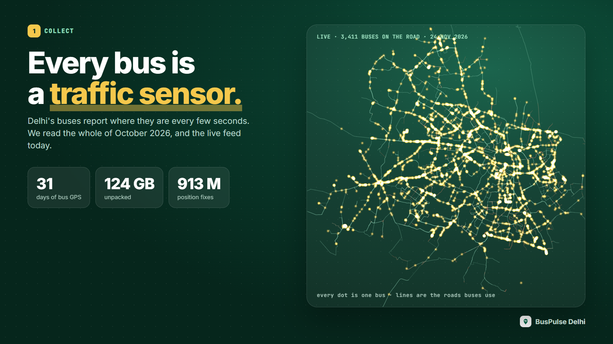<br><b>1. Collect.</b> 31 days of bus GPS, 913 M position fixes, plus the live feed. The map is Delhi drawn only from live bus positions.</td>
<td width="50%" valign="top">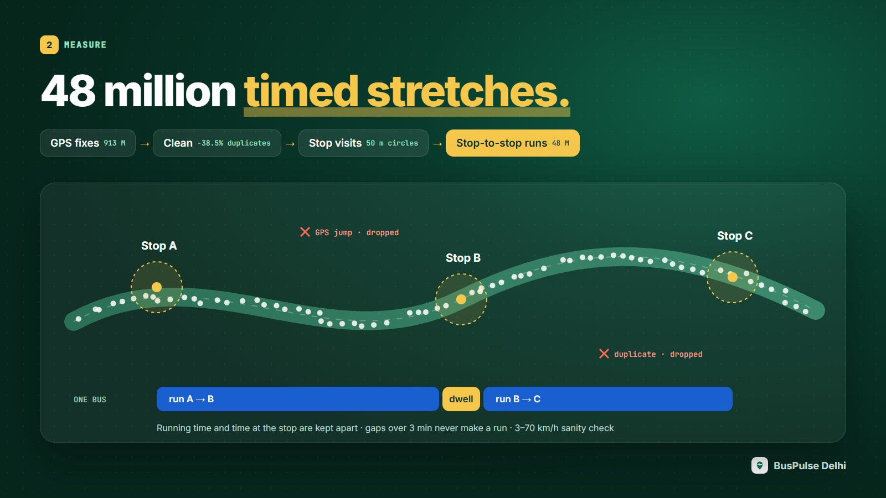<br><b>2. Measure.</b> Clean the fixes, find stop visits, and time the bus between every two stops: 48 M runs, running time and stop time kept apart.</td>
</tr>
<tr>
<td valign="top">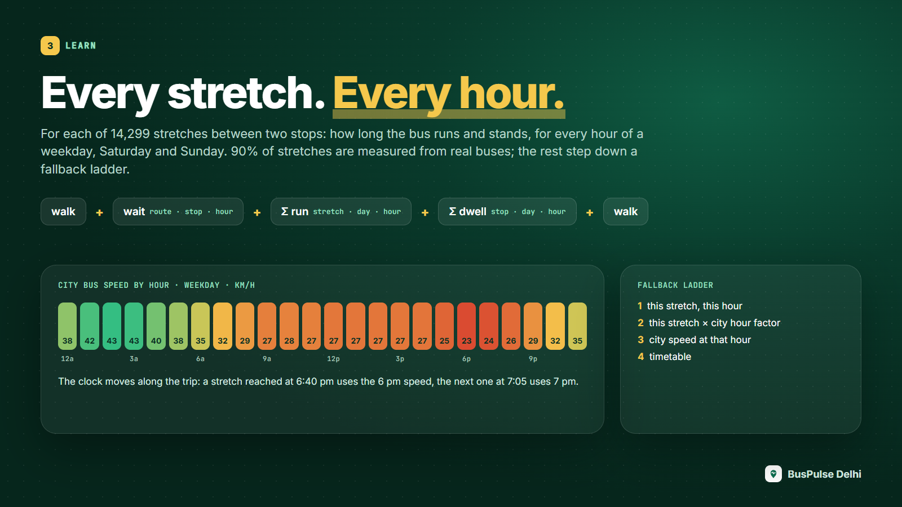<br><b>3. Learn.</b> A time for each of 14,299 stretches at every hour and day type; 90% measured from real buses, the rest from a fallback ladder.</td>
<td valign="top">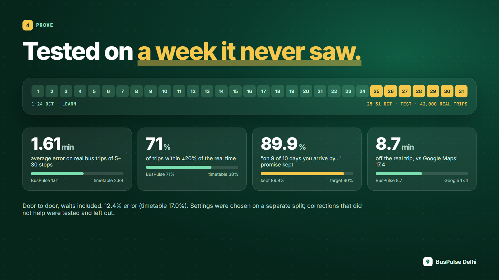<br><b>4. Prove.</b> Trained on 1–24 Oct, tested on 25–31 Oct, a week it never saw, against real buses and Google Maps.</td>
</tr>
</table>

<details><summary><b>Architecture diagram</b></summary>

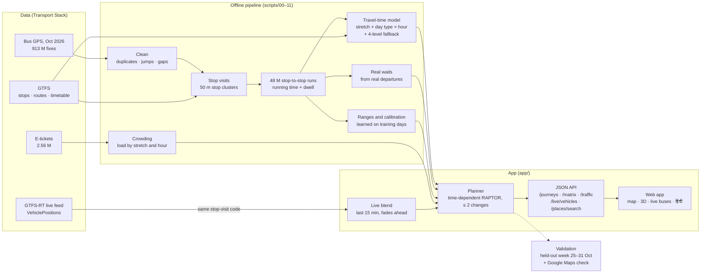

</details>

In one line, for a trip leaving at hour *h* on day type *d* (weekday / Saturday / Sunday):

```
total = walk + Σ legs [ wait(route, stop, d, h) + Σ stretches run(s, d, h) + Σ stops passed dwell(stop, d, h) ] + walk
```

`run` and `dwell` are measured from real buses (winsorised means), `wait` from real departures; when a stretch
has too little data, `run` steps down the fallback chain (city hourly factor → city speed → timetable), and
the hour moves along the trip as the bus advances.

1. **GPS → stop visits → stop-to-stop stretches.** Clean (38.5 % duplicates, jumps, gaps), snap to 50 m stop
   clusters, detect stop visits, keep the time between consecutive stops on the same GTFS route, with running time and
   time at the stop separately ([DATA_QUALITY.md](docs/DATA_QUALITY.md)).
2. **Model.** Per stretch × day type × hour (winsorised mean), with a fallback chain for sparse roads and hours
   (stretch-hour → stretch × city hourly factor → city speed at that hour → timetable).
3. **Planner.** Time-dependent, frequency-based RAPTOR (≤ 2 changes) on that model; waits from real headways;
   whole-ride and wait calibration learned from real buses on training days; live blend.

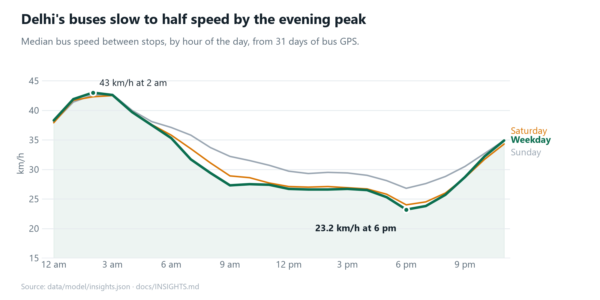

Details, assumptions and limits: **[docs/TECH_NOTE.md](docs/TECH_NOTE.md)** · validation:
**[docs/VALIDATION.md](docs/VALIDATION.md)** (stop-to-stop: [validation_results.md](docs/validation_results.md),
whole rides: [RIDE_VALIDATION.md](docs/RIDE_VALIDATION.md), model selection: [EXPERIMENTS.md](docs/EXPERIMENTS.md),
stress: [stress_results.md](docs/stress_results.md)) · crowding checks: [CROWDING_CHECKS.md](docs/CROWDING_CHECKS.md) ·
operator insights: [INSIGHTS.md](docs/INSIGHTS.md)

## Limits (honestly)

About 10 % of stretches have no GPS observation and use fallbacks (the app shows how much of each trip is measured);
waits are expected values, not predictions for a specific bus, and are still ~3 min optimistic on average;
crowding's absolute scale rests on the 3–4 % e-ticket share. The live GTFS-RT feed was connected on 24 Nov 2026,
so the live blend has not yet been validated over a full week of live data (the held-out-week numbers use
the replay).

## Phase 2 readiness

Stretch speeds by hour feed **Problem 4** (traffic-aware EV feeder routes); `/matrix` serves **Problem 3** OD work;
the ticket → stretch load pipeline extends to metro + bus for **Problem 5**.

## Repo

```
config.py        every assumption in one place        run.py           one-command start
app/             gtfs · gpsproc · traveltime · live · gtfsrt · calibration · ridecheck · crowding · planner · handlers · api · serve_stdlib
scripts/         00–11 pipeline steps (each prints its match/drop rates), make_all.ps1
web/index.html   the map page                         docs/            tech note, validation, data quality
tests/           synthetic Delhi + end-to-end tests  bundle/          compact model files for deploys
```

Data: Transport Stack / IIIT Delhi (GPS, tickets), DTC/DoT (GTFS). Map © OpenStreetMap contributors.
