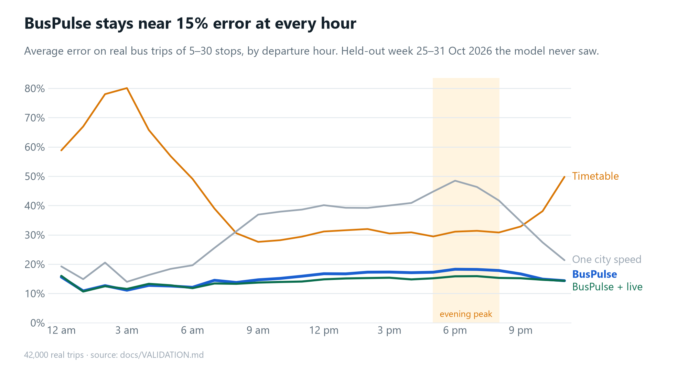
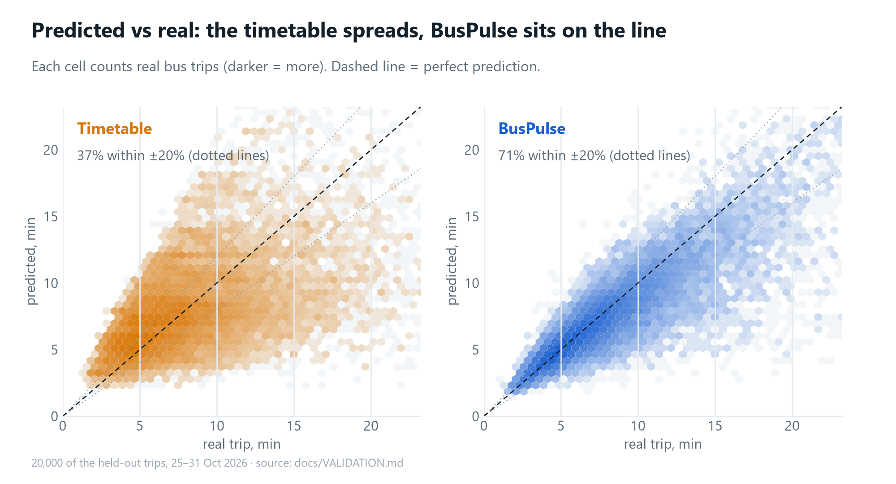
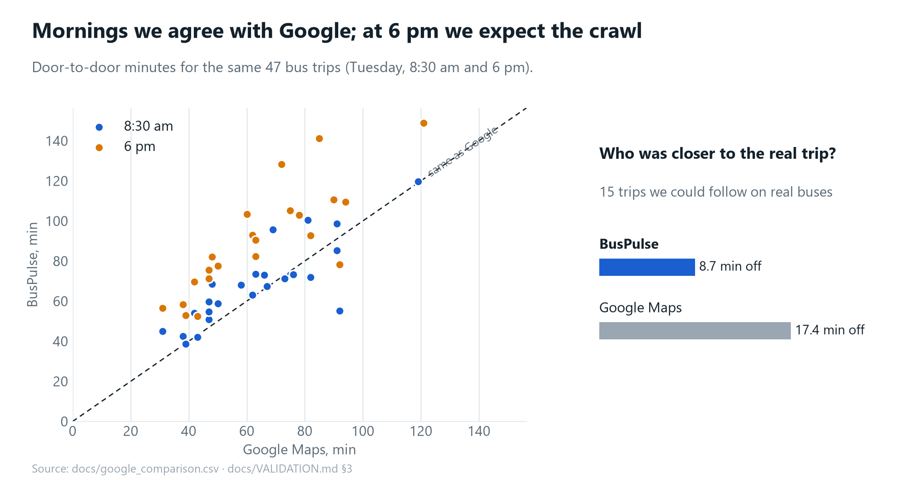

# BusPulse Delhi — validation report

**Rule: the model never sees the week it is tested on.** It is trained on GPS of **1–24 Oct 2026**; every number
below is measured on **real buses of 25–31 Oct** (a full Sunday–Saturday week). Settings were chosen on a separate
split (train 1–17, test 18–24 Oct), so the held-out week was never used to pick anything
([EXPERIMENTS.md](EXPERIMENTS.md)).

## Headline

| What is predicted | Compared with real buses (held-out week) | GTFS timetable | **BusPulse** |
|---|---|---|---|
| **Door to door** — walk + real wait + real ride (96 trips, median 72 min) | MAPE | 17.0 % | **12.4 %** |
| | mean absolute error | 12.1 min | **8.7 min** |
| | within ±20 % | 66 % | **80 %** |
| Bus ride, boarding → alighting stop (378 planned legs, median 21 min) | MAPE | 26.1 % | **16.6 %** |
| | mean absolute error | 6.7 min | **4.5 min** |
| | within ±20 % | 46 % | **70 %** |
| Stop-to-stop travel time (42,000 trip chains of 5–30 stops) | MAPE | 33.2 % | **15.9 %** (14.4 % with live data) |
| | within ±20 % | 38 % | **71 %** (75 % with live data) |
| "On 9 of 10 days you arrive by …" | share of real rides that made it | — | **89.9 %** (claimed 90 %) |
| Wait at the first stop (275 legs) | mean error (bias) | −7.1 min | **−2.8 min** |
| **vs Google Maps** — trips checkable against real buses (15 of 47) | mean abs. difference from the real trip | Google Maps 17.4 min | **8.7 min** (closer on 10 of 15) |

Timetable error grows at night (60 % MAPE 00–06 h) and on long rides; BusPulse stays at 13–18 % at every hour.

## 1. Whole bus rides — does the planner's answer match real buses?

[RIDE_VALIDATION.md](RIDE_VALIDATION.md) · `scripts/11_validate_rides.py`

420 random trips (3–18 km, 06–22 h) on the held-out days. For every bus leg of the planner's best option, the real
buses of the **same route** that **day** that left the boarding stop within ±15 min of the planned time are
followed through their GPS stop visits to the alighting stop.

| | legs | MAE min | bias min | MAPE % | within 20 % |
|---|---|---|---|---|---|
| GTFS timetable | 378 | 6.7 | −2.0 | 26.1 | 46 |
| GPS stretch model alone | 378 | 5.4 | −4.3 | 17.6 | 67 |
| **BusPulse planner** (stretch model + whole-ride calibration) | 378 | **4.5** | −2.2 | **16.6** | **70** |
| BusPulse planner + live blend (360 legs; without live on the same legs: 16.6 %, 69 %) | 360 | 4.5 | −2.2 | 16.5 | 70 |

By ride length the timetable's MAPE is 30 / 26 / 22 / 23 % for rides of < 15 / 15–30 / 30–45 / > 45 min;
BusPulse's is 18 / 16 / 17 / 16 %.

**Door to door**: 96 of the trips had real rides on every leg and a real wait at a well-detected stop
(real = planned walking + real waits + real rides; median 72 min, 48 % with a change). BusPulse: MAE 8.7 min,
MAPE 12.4 %, 80 % within ±20 %; timetable: 12.1 min, 17.0 %, 66 %.

**Range honesty** (whole rides): inside "usually" (p25–p75) 43.9 % (claimed 50), below p85 79.9 % (85),
below p90 89.9 % (90), inside p10–p90 80.2 % (80).

**Waits**: real mean wait 16.4 min; BusPulse predicts 13.6 (bias −2.8, MAE 9.4), the timetable 9.1
(bias −7.1, MAE 10.1). Delhi buses come less often than scheduled, and on routes the GPS barely sees, real waits
are ~6× what the timetable promises — the planner steers riders towards routes that actually run.

## 2. Stop-to-stop travel times — the traffic model itself

[validation_results.md](validation_results.md) · `scripts/04_validate.py`

42,000 chains of 5–30 consecutive stops cut from real bus trips on 25–31 Oct (actual = leaving the first stop →
reaching the last).

| model (ablation: each row adds one part) | MAE min | MAPE % | within 20 % |
|---|---|---|---|
| 1. GTFS timetable | 2.8 | 33.2 | 38.1 |
| 2. + GPS history, all hours averaged | 2.1 | 21.5 | 56.0 |
| 3. + hour of day & day type (**the model**) | 1.6 | 15.9 | 71.0 |
| 4. + live blend (last 15 min of GPS) | 1.4 | 14.4 | 75.3 |

By time of day (MAPE, model / timetable): 00–06 h 12.9 / 59.9 · 06–10 h 13.9 / 35.1 · 10–16 h 16.3 / 30.2 ·
16–20 h 17.7 / 30.7 · 20–24 h 16.4 / 35.1. By day type: weekday 15.8, Saturday 17.0, Sunday 15.5.

## 3. Versus Google Maps

[google_comparison.md](google_comparison.md) · `scripts/05_google_compare.py`

**47 trips**: 25 landmark origin–destination pairs at **08:30** and 22 of them at **18:00**. Google Maps was asked
for a **bus-only** trip on Tuesday 1 Dec 2026 with "Depart at"; we took the top result, or the first bus-only
card when Google's top cards used the metro. These are hand-read values, and Google's raw answers are not
stored. BusPulse plans the same trip for the held-out Tuesday. Where real buses of BusPulse's suggested route ran
those legs that week, we also know what the trip **really** took (planned walk + real wait + real ride).

| | 08:30 (25 trips) | 18:00 (22 trips) |
|---|---|---|
| Google Maps, mean | 63.9 min | **64.6 min** |
| BusPulse, mean | 68.2 min | **90.2 min** |
| GTFS timetable, mean | 71.0 min | 76.0 min |

**In the morning BusPulse and Google agree**: median difference 11.8 %, 72 % of trips within ±20 % of each other,
correlation 0.83. **In the evening they part**: Google's times barely change between the morning and evening
peaks, while real buses in our GPS run much slower at 6 pm (city-wide bus speed 29 km/h at 08:00 vs 23 km/h at
18:00, section 6).

**Who is closer to what really happened?** 15 of the trips can be checked end to end against real buses:

| | mean abs. difference from the real trip | closer to the real trip |
|---|---|---|
| **BusPulse** | **8.7 min** (08:30: 8.7 · 18:00: 8.6) | **10 of 15** |
| Google Maps | 17.4 min (08:30: 13.2 · 18:00: 23.8) | 5 of 15 |

Two rides checked against the real buses of the held-out week:

| 18:00 ride | Google Maps | BusPulse | real buses (median, range) |
|---|---|---|---|
| 463, Shaheen Bagh Thokar 8 → Govind Puri | ~20 min (timetable: 20.5) | 36 min | **45 min** (40–65, 8 rides) |
| 507, Okhla Extension → Lajpat Nagar | ~28 min (timetable: 23) | 52 min | **53 min** (49–57, 7 rides) |

Google's documentation says its bus itineraries start from the agency's GTFS schedule, with real-time data or
traffic-based delay predictions layered on where available ([Google Transit: About realtime
transit](https://support.google.com/transitpartners/answer/1335046?hl=en);
[Google Research, *Predicting bus delays with machine learning*, 2019](https://research.google/blog/predicting-bus-delays-with-machine-learning/)).
We do not know Google's internals. We only measured that, for trips planned a week ahead, its in-bus times sit
close to the timetable while the real buses do not.

**Where BusPulse loses**: 5 of the 15 checkable trips, e.g. Rohini Sec 18 → Kashmere Gate at 18:00 (BusPulse 93,
real 73, Google 62) and Okhla → Lajpat Nagar at 08:30 (45 / 37 / 31). In both, BusPulse expected a long wait and
the real bus came sooner. In the morning BusPulse is on average **6 min short** on long trips (as is Google). The
corrections we tried for this are in section 4.

Honest limits: 47 trips and 15 real-trip checks are a small sample; Google was queried for a future date (no live
data), and BusPulse for the held-out week. Full table: [google_comparison.md](google_comparison.md).

## 4. How the settings were chosen

[EXPERIMENTS.md](EXPERIMENTS.md) · `scripts/10_experiments.py`

16 model variants (winsorising level, median vs mean, recency weighting, shrinkage) and a 27-point grid for the
live blend, compared on the selection split. Chosen: winsorised mean 15–85 % (MAPE 16.41 → 15.96 on the selection
split), live window 15 min / fade 60 min. Recency weighting looked good on the held-out week but not on the
selection split, so it was **not** used.

Planner corrections ([EXPERIMENTS_PLANNER.md](EXPERIMENTS_PLANNER.md)): ride factors by time × ride length × route,
and wait factors by time of day, fitted on 4–17 Oct and scored on 18–24 Oct (3,700 legs). None moved the error
(ride MAE 4.65 → 4.65 min, wait MAE 11.01 → 10.97 min), so v5 was kept. The remaining error is bus-to-bus
randomness that history cannot predict. Only live positions can reduce it.

## 5. Robustness

[stress_results.md](stress_results.md) · `scripts/06_loadtest.py` — against the deploy bundle (what Render runs)

* One user at a time: **p50 ≈ 0.5 s, p95 ≈ 0.85 s** per complete answer (3 options, 24-hour profile, crowding,
  range). 200 random queries with 10 concurrent users: **0 server errors**, 98 % find a journey; < 400 MB RAM.
* Edge cases answered with clear messages: no stop nearby, 2 am (first useful bus), invalid / out-of-area
  coordinates, same origin and destination, unknown or junk place names (`<script>`, SQL-like text), bad time,
  bad mode, missing parameter, 300 m trips, typos ("nehru plce", "kashmiri gate"), Delhi nicknames ("cp", "ndls").
* 9 end-to-end tests on a synthetic city with known travel times (duplicates, GPS jumps, gaps, shuffled rows)
  run in CI (`tests/`).

## 6. Traffic, stops and waits move together

From all 31 days of GPS (weekdays, city-wide, stops where the route is well detected):

| hour | bus speed | median time at a stop | mean wait for the next bus |
|---|---|---|---|
| 06:00 | 35 km/h | 7 s | 12.9 min |
| 09:00 | 27 km/h | 11 s | 15.2 min |
| 18:00 | **23 km/h** | 11 s | **17.0 min** |
| 22:00 | 32 km/h | 7 s | 17.3 min (fewer buses at night) |

Across hours, slower traffic goes with longer halts at stops (correlation −0.89) and longer waits (−0.68): in the
slowest quarter of hours buses halt 47 % longer and riders wait 18 % longer than in the fastest. Rush hour also
brings more passengers, so part of the longer halts may be boarding rather than traffic. BusPulse does not assume a
link: running time, stop time and waits are each learned **per stretch or stop, per hour and day type**, so a
slow 6 pm automatically carries slower running, longer halts and longer waits. Time at a stop (dwell) is
modelled **separately** from running time; signal delay stays inside the running time of its stretch.

## 7. Data quality

[DATA_QUALITY.md](DATA_QUALITY.md) · [CROWDING_CHECKS.md](CROWDING_CHECKS.md)

913 M raw GPS rows → 38.5 % exact duplicates removed → 560 M clean fixes → 97.8 M stop visits → 48.2 M
stop-to-stop observations (kept when the two stops are adjacent on a GTFS route, no data gap, 3–70 km/h).
99.2–99.7 % of the route IDs in the GPS exist in the GTFS, every day. Holidays (2 Oct, 20 Oct) show Sunday-like speeds.
Tickets: 98.4 % of route codes and 92.6 % of start+end stop names matched; week-to-week correlation of route ×
hour boardings 0.96.

## What we do not claim

* The live feed is a **replay** of a held-out day through the same interface a GTFS-RT connector would use.
* "Actual" rides and waits come from GPS stop visits, so buses with GPS switched off are invisible to both the
  model and this report.
* Crowding levels rest on an assumed 3.5 % e-ticket share; rankings (which hour, which bus is fuller) are more
  reliable than absolute passenger counts.
